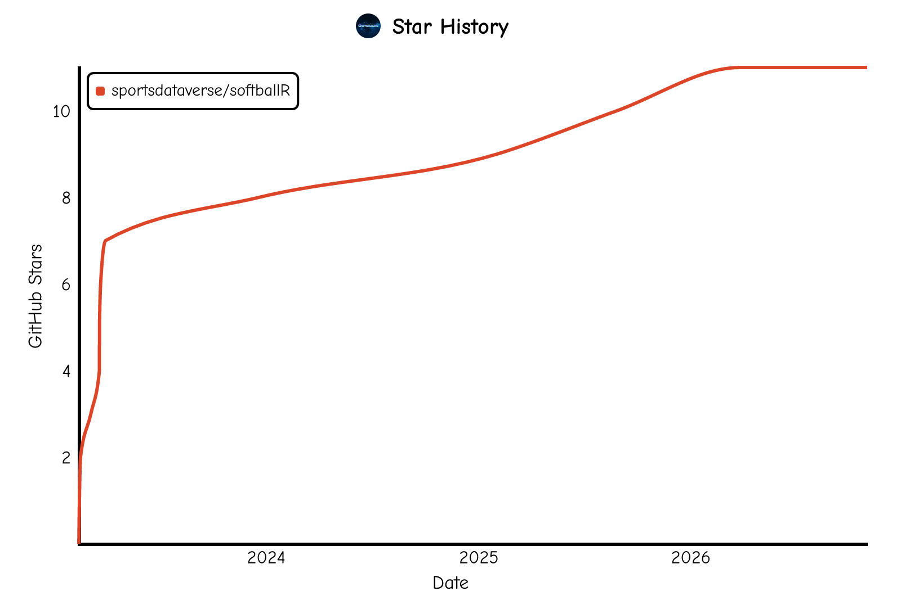

# **softballR** <a href='https://github.com/sportsdataverse/softballR/'></a>

<!-- badges: start -->
[](https://sportsdataverse.r-universe.dev/softballR)
[](https://github.com/sportsdataverse/softballR/)
[](https://app.codecov.io/gh/sportsdataverse/softballR)
[](https://lifecycle.r-lib.org/articles/stages.html#stable)
[](https://github.com/sportsdataverse/softballR/blob/main/LICENSE.md)
[](https://github.com/sportsdataverse/softballR/graphs/contributors)
[](https://github.com/sportsdataverse/softballR)
[](https://x.com/SportsDataverse)
<!-- badges: end -->

<b>softballR</b> is an R package for acquiring NCAA softball data.

The package has functions for obtaining game-by-game scores, box scores, (some) play-by-play, and some different rankings websites. 

## **Installation**

You can install the latest build from [R-universe](https://sportsdataverse.r-universe.dev/softballR) with:

```r
install.packages("softballR", repos = c("https://sportsdataverse.r-universe.dev", getOption("repos")))
```

You can install the development version of [**`softballR`**](https://github.com/sportsdataverse/softballR/) from GitHub with:

```r
if (!requireNamespace("pak", quietly = TRUE)) install.packages("pak")
pak::pak("sportsdataverse/softballR")
# or, with remotes:
# if (!requireNamespace("remotes", quietly = TRUE)) install.packages("remotes")
# remotes::install_github("sportsdataverse/softballR")
```

## **Quick start**

### Get scores for all games in a given season

``` r
scoreboard <- softballR::load_ncaa_softball_scoreboard(season = 2023)
```

### Get box scores for all games in a given season (Only has 2023 data for now)

``` r
hitting <- softballR::load_ncaa_softball_playerbox(season = 2023, category = "Hitting")

pitching <- softballR::load_ncaa_softball_playerbox(season = 2023, category = "Pitching")
```

### Get all NCAA play by play data for a given team and season (2021-2023 for now)

``` r
# Use Oklahoma 2022 as example

team_id <- softballR::ncaa_softball_teams(2022) |>
    dplyr::filter(team_name == "Oklahoma") |>
    dplyr::pull(softball_id)
    
pbp <- softballR::ncaa_softball_season_pbp(team_id)
```

## **Documentation**

**`softballR`** has no pkgdown site yet. Every exported function has a help page; browse them in R with:

```r
help(package = "softballR")
```

Release notes are in [NEWS.md](https://github.com/sportsdataverse/softballR/blob/main/NEWS.md).

## **Companion packages**

- [**`sportyR`**](https://sportyR.sportsdataverse.org/) (`install.packages("sportyR")`) draws a regulation NCAA softball field with [`sportyR::geom_softball("ncaa")`](https://sportyR.sportsdataverse.org/reference/geom_softball.html).
- [**`sdvplotR`**](https://sdvplotR.sportsdataverse.org/) (`pak::pak("sportsdataverse/sdvplotR")`) draws the same field through [`sdv_surface("ncaa_softball")`](https://sdvplotR.sportsdataverse.org/reference/sdv_surface.html).
- [**`sportsdataverse-py`**](https://py.sportsdataverse.org/) is the Python package; its `sportsdataverse.baseball.college_softball` module covers college softball.

## **The SportsDataverse**

[**`softballR`**](https://github.com/sportsdataverse/softballR) is part of the [SportsDataverse](https://sportsdataverse.org/), a set of
open-source packages for sports data.

| Package | Sport / Scope |
|---|---|
| [**cfbfastR**](https://cfbfastR.sportsdataverse.org/) | College football |
| [**hoopR**](https://hoopR.sportsdataverse.org/) | Men's basketball (NBA and NCAA) |
| [**wehoop**](https://wehoop.sportsdataverse.org/) | Women's basketball (WNBA and NCAA) |
| [**fastRhockey**](https://fastRhockey.sportsdataverse.org/) | Hockey (NHL and PWHL) |
| [**baseballr**](https://billpetti.github.io/baseballr/) | Baseball (MLB, MiLB, NCAA) |
| [**softballR**](https://github.com/sportsdataverse/softballR) | College softball |
| [**oddsapiR**](https://oddsapiR.sportsdataverse.org/) | Sports betting odds |
| [**recruitR**](https://recruitR.sportsdataverse.org/) | College football recruiting |
| [**usfootballR**](https://usfootballR.sportsdataverse.org/) | US soccer |
| [**cfbseedR**](https://cfbseedR.sportsdataverse.org/) · [**cfb4th**](https://cfb4th.sportsdataverse.org/) | CFB playoff simulation · fourth-down decisions |
| [**cfbplotR**](https://cfbplotR.sportsdataverse.org/) · [**sdvplotR**](https://sdvplotR.sportsdataverse.org/) · [**sportyR**](https://sportyR.sportsdataverse.org/) | Logos, colors, tables · playing surfaces |
| [**sportsdataverse-R**](https://r.sportsdataverse.org/) | Umbrella R metapackage |
| [**sportsdataverse-py**](https://py.sportsdataverse.org/) · [**sportsdataverse.js**](https://js.sportsdataverse.org/) | Python and Node.js |

See the full ecosystem at [sportsdataverse.org](https://sportsdataverse.org/).

Its sibling packages publish free printable one-page cheat sheets at
**[sportsdataverse.org/cheatsheets](https://sportsdataverse.org/cheatsheets)** —
there is no softballR sheet yet, but the same template is available if you
would like one built.

## **Follow the [SportsDataverse](https://x.com/SportsDataverse) on X and star this repo**

[](https://x.com/SportsDataverse)

[](https://github.com/sportsdataverse/softballR)

<a href="https://github.com/sportsdataverse/softballR">
  <picture>
    <source media="(prefers-color-scheme: dark)" srcset="https://raw.githubusercontent.com/sportsdataverse/softballR/star-history/star-history-dark.svg">
    
  </picture>
</a>

## **Our Authors**

-   [Tyson King](https://x.com/tking0426)
<a href="https://x.com/tking0426" target="blank"></a>
<a href="https://github.com/tmking2002" target="blank"></a>

## **Citations**

To cite the `softballR` R package in publications, use:

``` bibtex
@misc{king_softballR,
  author = {Tyson King},
  title = {softballR: Easily Accessible College Softball Data.},
  url = {https://github.com/sportsdataverse/softballR},
  note = {R package version 1.4.0},
  year = {2023}
}
```

`citation("softballR")` returns this entry with the installed version number attached.

## **License**

[**`softballR`**](https://github.com/sportsdataverse/softballR) is released under the [MIT License](https://github.com/sportsdataverse/softballR/blob/main/LICENSE.md) (`MIT + file LICENSE`).
